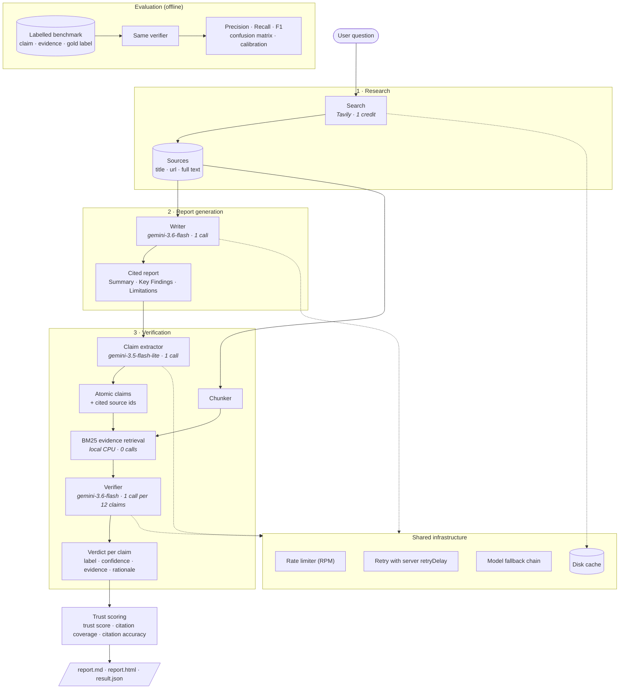

# ATLAS

### Agentic Trust and Literature Analysis System

ATLAS researches a question, writes a cited report, and then **fact-checks every claim in that report** against the retrieved evidence. Each claim is labelled **Supported**, **Partially Supported**, **Unsupported**, or **Contradicted**, with a confidence score, the evidence passages behind the verdict, and an overall trust score for the report.

It also ships an **evaluation framework** that measures how accurate the verifier itself is (precision, recall, F1, confusion matrix) on a labelled benchmark.

Built on the **Gemini API** and **Tavily** search, and designed to run comfortably on both services' free tiers.

---

## Architecture



### How a request flows

| Step | What happens | Cost |
|---|---|---|
| **Search** | One Tavily `basic` search fetches up to 6 sources with their full page text. | 1 Tavily credit |
| **Write** | Gemini writes a report using only those sources, citing `[n]` after every factual sentence. The Sources list is built from the search results, never by the model, so URLs can't be invented. | 1 Gemini call |
| **Extract** | A Flash-Lite call splits the report into atomic, self-contained claims and records which sources each one cites. If it fails, a free regex fallback treats every cited sentence as a claim. | 1 Gemini call |
| **Retrieve** | Sources are cut into ~700-character passages and ranked per claim with BM25. The best passage from each *cited* source is always included, so ATLAS can tell whether the citation itself backs the claim. | Free (local) |
| **Verify** | The verifier judges claims **in batches** against their passages only, never its own knowledge. Claims with no matching passage are marked unsupported without an API call. | 1 Gemini call per 12 claims |
| **Score** | Trust score, citation coverage, citation accuracy and mean confidence are computed locally. | Free |

A typical report costs **3 Gemini calls and 1 Tavily credit** whatever the claim count (up to 12 claims; 4 calls up to 24). Re-running the same question costs nothing thanks to the cache.

### Metrics

**Per report**

| Metric | Meaning |
|---|---|
| Trust score (0-100) | `(supported + 0.5 × partial − 0.5 × contradicted) / claims`, clamped to 0-100. Contradictions count against the report. |
| Citation coverage | Share of claims that carry at least one `[n]` citation. |
| Citation accuracy | Share of cited claims whose supporting evidence comes from a source they actually cite. |
| Mean confidence | Average verifier confidence. |

**Verifier evaluation** (`python -m atlas evaluate`)

| Metric | Meaning |
|---|---|
| Accuracy, macro F1, weighted F1 | Four-way label agreement with the gold labels. |
| Per-label precision / recall / F1 | Which verdicts the verifier gets right or wrong. |
| Problem-claim detection | Binary view: unsupported + contradicted versus the rest. Recall = share of bad claims caught. |
| Confusion matrix | Which labels get mixed up. |
| Calibration | Mean confidence when right vs. wrong, and accuracy at confidence ≥ 0.8. |

---

## Design choices for free-tier use

| Choice | Why |
|---|---|
| **Batched verification** | One call checks up to 12 claims instead of one call each, cutting requests about 10×. |
| **Local BM25 retrieval** | Evidence matching needs no embedding API, so it costs no quota and runs in milliseconds. |
| **Flash-Lite for extraction** | Splitting text into claims is easy, so it runs on the cheapest, fastest model. |
| **Structured JSON output** | Gemini returns schema-validated JSON (Pydantic), so there are no parse failures to retry. |
| **Disk cache** | Every Gemini and Tavily response is cached by request hash; repeat runs and evaluation reruns are free. |
| **Client-side rate limiter** | Stays under the per-minute limit (`GEMINI_RPM`, default 10) instead of hitting 429s. |
| **Smart retries** | 429s wait exactly the `retryDelay` Google returns; 5xx errors back off exponentially. |
| **Model fallback chain** | When a model is unavailable or its daily quota runs out, the call moves on to the next model (`ATLAS_FALLBACK_MODELS`) instead of failing. |
| **Basic search depth** | Tavily `basic` costs 1 credit (`advanced` costs 2) and still returns full page text. |

---

## Quick start

**Requirements:** Python 3.10+, a free [Gemini API key](https://aistudio.google.com/apikey) and a free [Tavily API key](https://app.tavily.com) (1,000 credits/month).

```bash
git clone https://github.com/mudit-31/atlas.git
cd atlas
pip install -r requirements.txt
cp .env.example .env        # then put your two keys in .env
```

### Research a question

```bash
python -m atlas research "What is NVIDIA's AI strategy?"
```

Output goes to `data/outputs/<timestamp>_<slug>/`:

- `report.html`: the report with colour-coded verdicts, evidence and sources (open it in a browser)
- `report.md`: the report plus a verification table
- `result.json`: everything, machine-readable

### Fact-check existing text

Check any text, for example another chatbot's answer, against fresh web evidence:

```bash
python -m atlas verify answer.md --question "NVIDIA AI strategy"
```

### Evaluate the verifier

```bash
python -m atlas evaluate                      # bundled 40-example benchmark (4 Gemini calls)
python -m atlas evaluate --model gemini-3.5-flash-lite
python -m atlas evaluate --dataset my_data.jsonl --limit 100
```

Results are saved to `data/eval_runs/<timestamp>/` as `results.json` and `report.md`.

### Web UI

```bash
streamlit run app.py
```

The UI has three tabs: **Research**, **Verify text** and **Evaluation** (a browser for past evaluation runs).

### Options

Every setting can go in `.env`; see [.env.example](.env.example). The most useful:

| Variable | Default | Purpose |
|---|---|---|
| `ATLAS_WRITER_MODEL` | `gemini-3.6-flash` | Writes the report |
| `ATLAS_VERIFIER_MODEL` | `gemini-3.6-flash` | Judges claims |
| `ATLAS_EXTRACTOR_MODEL` | `gemini-3.5-flash-lite` | Splits the report into claims |
| `ATLAS_FALLBACK_MODELS` | `gemini-3.5-flash-lite,gemini-2.5-flash-lite` | Used when a model is unavailable or out of quota |
| `ATLAS_THINKING_LEVEL` | *(model default)* | e.g. `low` for faster, cheaper Gemini 3 calls |
| `GEMINI_RPM` | `10` | Client-side requests-per-minute cap |
| `ATLAS_MAX_SOURCES` | `6` | Web sources per question |
| `ATLAS_MAX_CLAIMS` | `25` | Claims verified per report |
| `ATLAS_VERIFY_BATCH_SIZE` | `12` | Claims per verification call |
| `ATLAS_CACHE` | `true` | Cache API responses on disk |

CLI flags: `--no-cache`, `--max-sources N`, `--max-claims N`, `-v` for detailed logs.

---

## Benchmark data

`data/benchmark/atlas_seed_v1.jsonl` holds 40 hand-labelled examples, 10 per label. They use **fictional** entities, so the verifier can only succeed by reading the evidence rather than recalling facts. The cases are deliberately tricky: transposed digits, founding city vs. current HQ, compound claims that are half supported, plausible inferences the evidence doesn't state, and reversed trends.

To add your own data, write JSON Lines in the same format:

```json
{"id": "x1", "claim": "...", "evidence": ["passage 1", "passage 2"], "label": "contradicted"}
```

---

## Project structure

```
atlas/
├── atlas/
│   ├── cli.py            # python -m atlas research | verify | evaluate
│   ├── pipeline.py       # orchestration + saving runs
│   ├── config.py         # settings from .env
│   ├── llm.py            # Gemini: rate limit, retries, fallback, cache
│   ├── search.py         # Tavily search
│   ├── report.py         # report writer
│   ├── claims.py         # claim extraction (+ no-API fallback)
│   ├── retrieval.py      # chunking + BM25
│   ├── verify.py         # batched claim verification
│   ├── scoring.py        # trust metrics
│   ├── render.py         # Markdown / HTML output
│   ├── prompts.py        # all prompts in one place
│   ├── schemas.py        # Pydantic data models
│   └── evaluation/       # metrics + benchmark runner
├── app.py                # Streamlit UI
├── data/benchmark/       # labelled evaluation data
├── docs/                 # problem statement, specs, design notes
└── tests/                # offline test suite (no API keys needed)
```

## Tests

```bash
python -m pytest
```

All tests use fake Gemini and Tavily clients, so they run offline in a few seconds and need no API keys.

## Roadmap

- [x] Research assistant
- [x] Retrieval-augmented report generation with citations
- [x] Claim extraction
- [x] Evidence verification engine
- [x] Seed benchmark dataset
- [x] Evaluation framework
- [ ] Larger benchmark (import FEVER / SciFact subsets, label real ATLAS reports)
- [ ] Follow-up searches for unsupported claims
- [ ] Multi-agent planner that splits questions into sub-queries
- [ ] Deployment

## Limitations

- The verifier's confidence is the model's own estimate, not a calibrated probability; check it with `evaluate`.
- Verdicts are only as good as the retrieved sources: a true claim the sources don't mention is labelled *unsupported*.
- The writer and verifier use the same model family, so they may share blind spots. Running `evaluate` with different `--model` values shows how much this matters.
